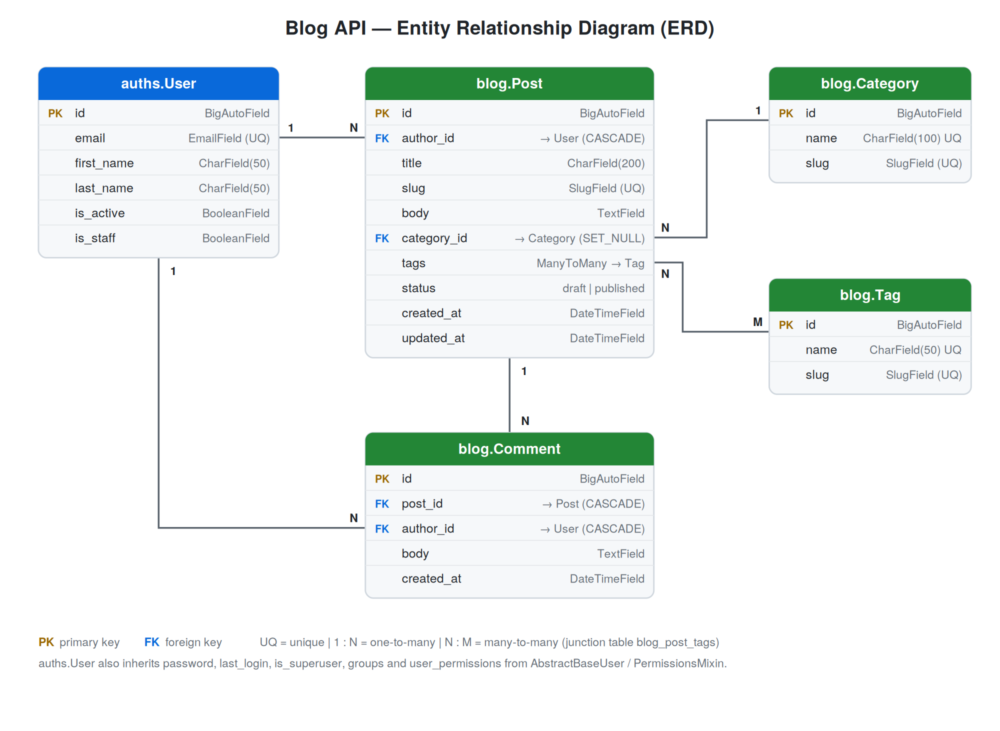
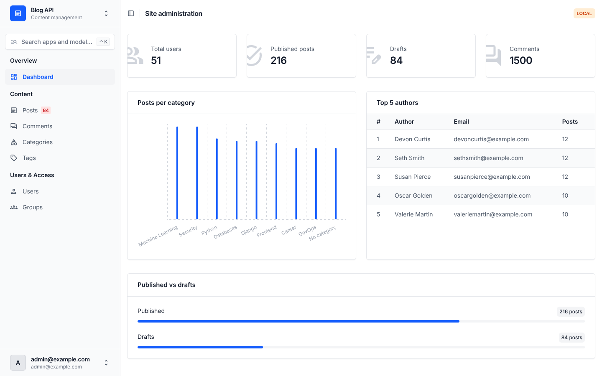
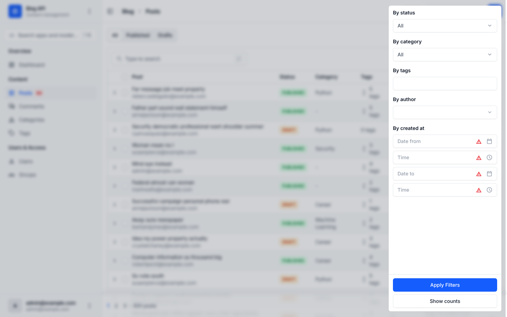
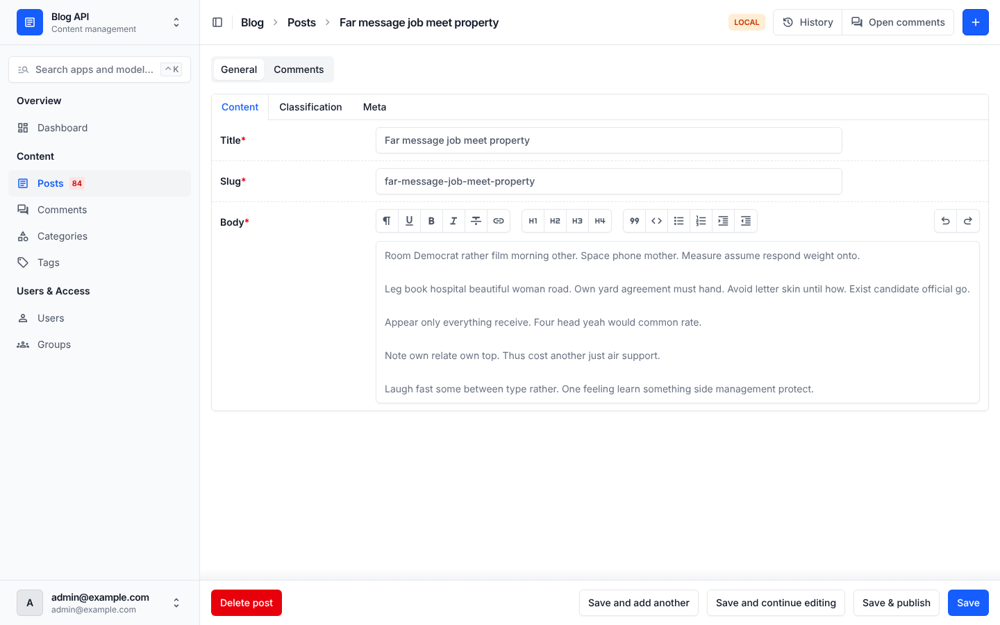
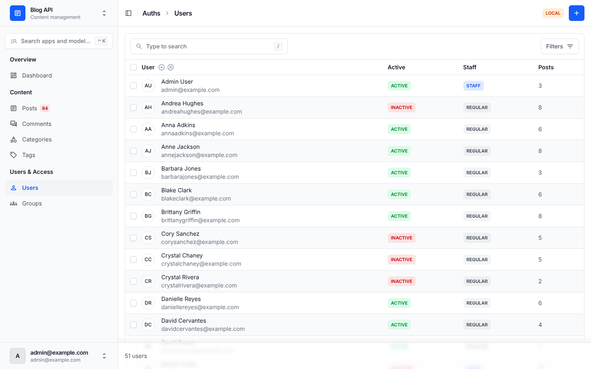

# Blog API

A blog REST API built with Django and Django REST Framework.
Homework 1 covers the project structure, configuration, the data model and the ERD.
Homework 2 adds a `seed` command with fake data and an admin panel built with Django Unfold.

## Tech stack

- Python 3.12+
- Django 5.2, Django REST Framework
- Django Unfold (admin theme)
- Faker (fake data for the `seed` command)
- python-decouple (configuration via `.env`)
- SQLite (local) / PostgreSQL (production)
- ruff (linting)

## Project structure

```
blog-api/
├── manage.py
├── requirements/
│   ├── base.txt          # shared dependencies
│   ├── dev.txt           # -r base.txt + dev tools (faker, ruff)
│   └── prod.txt          # -r base.txt + gunicorn, psycopg2
├── logs/                 # log files (ignored by git)
├── docs/
│   ├── erd.png           # ERD image
│   ├── erd.svg           # ERD source
│   └── screenshots/      # admin screenshots
├── apps/
│   ├── auths/            # custom user model (email login)
│   └── blog/             # categories, tags, posts, comments
│       ├── admin.py      # Unfold admin for blog models
│       ├── callbacks.py  # Unfold callbacks (dashboard, badge, tabs, env)
│       └── management/commands/seed.py
├── templates/
│   └── admin/index.html  # admin dashboard
└── settings/
    ├── .env              # secrets (never committed)
    ├── .env.example      # template for .env
    ├── conf.py           # reads .env via python-decouple
    ├── base.py           # shared settings
    ├── urls.py
    ├── wsgi.py
    ├── asgi.py
    └── env/
        ├── local.py      # DEBUG=True, SQLite
        └── prod.py       # DEBUG=False, PostgreSQL
```

Settings load order: `manage.py` → `settings/env/<BLOG_ENV_ID>.py` → `settings/base.py` → `settings/conf.py` → `settings/.env`.

## Getting started

```bash
git clone https://github.com/erasylmurat/blog-api.git
cd blog-api

python -m venv .venv
source .venv/bin/activate

pip install -r requirements/dev.txt

cp settings/.env.example settings/.env
# generate a secret key and put it into BLOG_SECRET_KEY:
python -c "import secrets; print(secrets.token_urlsafe(50))"

python manage.py migrate
python manage.py seed
python manage.py createsuperuser
python manage.py runserver
```

The admin site is available at http://127.0.0.1:8000/admin/.

## Environment variables

All variables are prefixed with `BLOG_` and read from `settings/.env`.

| Variable | Description | Default |
|---|---|---|
| `BLOG_SECRET_KEY` | Django secret key (required) | — |
| `BLOG_ENV_ID` | Environment: `local` or `prod` | `local` |
| `BLOG_ALLOWED_HOSTS` | Comma-separated list of allowed hosts | empty |
| `BLOG_DB_NAME` | PostgreSQL database name (prod) | `blog` |
| `BLOG_DB_USER` | PostgreSQL user (prod) | `postgres` |
| `BLOG_DB_PASSWORD` | PostgreSQL password (prod) | empty |
| `BLOG_DB_HOST` | PostgreSQL host (prod) | `localhost` |
| `BLOG_DB_PORT` | PostgreSQL port (prod) | `5432` |
| `BLOG_SQL_LOG` | Print every SQL query to the console (local) | `False` |

For production set `BLOG_ENV_ID=prod` and install `requirements/prod.txt`.

## Data model



### auths

**User** — custom user model (`AbstractBaseUser` + `PermissionsMixin`), logs in with email.

| Field | Type |
|---|---|
| `email` | `EmailField`, unique, `USERNAME_FIELD` |
| `first_name` | `CharField(50)`, required |
| `last_name` | `CharField(50)`, required |
| `is_active` | `BooleanField`, default `True` |
| `is_staff` | `BooleanField`, default `False` |

The custom manager provides `create_user` and `create_superuser`, lowercases the email and hashes the password.

### blog

| Model | Fields |
|---|---|
| **Category** | `name` (unique, 100), `slug` (unique) |
| **Tag** | `name` (unique, 50), `slug` (unique) |
| **Post** | `author` (FK User, CASCADE), `title` (200), `slug` (unique), `body`, `category` (FK Category, SET_NULL, nullable), `tags` (M2M Tag), `status` (`draft` / `published`), `created_at`, `updated_at` |
| **Comment** | `post` (FK Post, CASCADE), `author` (FK User, CASCADE), `body`, `created_at` |

## Seeding

`python manage.py seed` fills the database with fake data (Faker): users, categories, tags, posts and comments.

| Argument | Default | Description |
|---|---|---|
| `--users` | `20` | Number of users to create |
| `--posts` | `100` | Number of posts to create |
| `--comments` | `500` | Number of comments to create |
| `--clear` | off | Delete existing data before seeding (superusers are kept) |

```bash
$ python manage.py seed --users 50 --posts 300 --comments 1500
Users:       50 created
Categories:   8 created
Tags:        20 created
Posts:      300 created
Comments:  1500 created
Done in 0.71 seconds
```

- All seeded users have the password `seedpass123` (`SEED_PASSWORD`); about 10% are inactive and about 10% are staff.
- 8 categories and 20 tags with real names; existing ones are skipped.
- About 70% of posts are published, 30% are drafts, 10% have no category, each has 0–5 tags.
- Comments are added only to published posts.
- Objects are created with `bulk_create`; running the command twice does not fail.
- Other examples: `python manage.py seed --clear`, `python manage.py seed --users 0 --posts 50 --comments 0`, `python manage.py seed --help`.

## Admin

The admin uses [Django Unfold](https://unfoldadmin.com/docs/):

- custom sidebar (Overview / Content / Users & Access — the last one only for superusers), drafts badge on **Posts**;
- `Ctrl+K` / `Cmd+K` search over all models, `Local` / `Production` environment badge, blue colour palette;
- **Posts**: All / Published / Drafts tabs, colored status labels, tags dropdown, filters, expandable rows with comments, bulk / row / list / detail / *Save & publish* actions, edit form in tabs with a WYSIWYG editor and paginated comments inline;
- **Users**: header column with initials, colored labels, radio filters, form in tabs, Activate / Deactivate actions;
- **Dashboard**: cards, posts per category chart, top 5 authors, published vs draft progress.

To check for N+1 queries, set `BLOG_SQL_LOG=True` in `settings/.env` and open a list page.

### Dashboard



### Post list with filters



### Post edit page



### User list



## Git workflow

- Each homework is done in its own branch (`hw1`, `hw2`, ...).
- When finished, the branch is merged into `main` and is **not** deleted.

## Code style

- PEP 8, checked with `ruff`: `ruff check .`
- No magic strings or numbers, constants are used instead.
- Imports order: standard library and third party, Django REST Framework, Django, local.
- Management commands write output with `self.stdout.write`, never `print`.
- Type hints for function arguments and return values.
